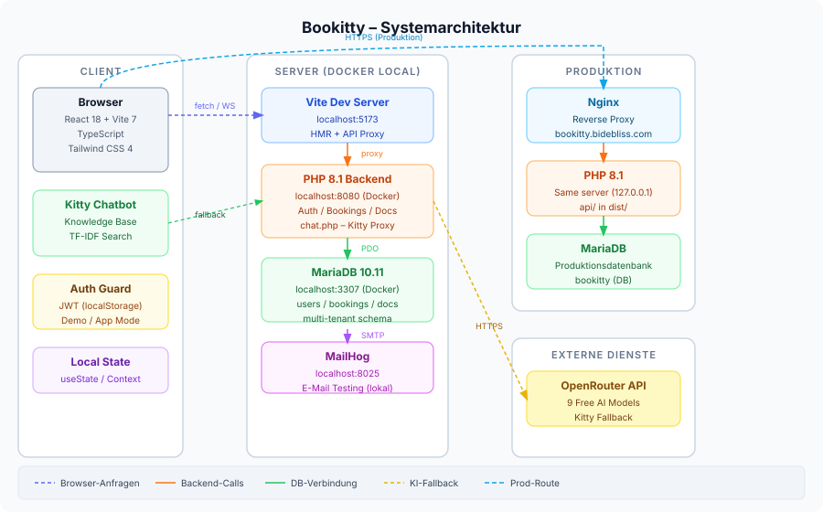

# Bookitty

Moderne Finanzbuchhaltungs-WebApp für Schweizer KMU — mit KI-Chatbot, automatischer Belegerkennung und intuitiver Buchungserfassung.

## Funktionen

### Buchhaltung
- **Dashboard** – Kennzahlen, Kontostand, letzte Buchungen auf einen Blick
- **Buchungen** – Einnahmen/Ausgaben erfassen, bearbeiten, nach Zeitraum/Kategorie filtern
- **Bilanz** – Aktiven/Passiven nach Schweizer KMU-Kontenrahmen, PDF-Export
- **Erfolgsrechnung** – Ertrag/Aufwand-Übersicht mit Jahresvergleich
- **Dokumente** – PDF- und Bildbelegs-Import mit automatischer OCR-Erkennung
- **Bankabgleich** – Import von CAMT.052/053/054, CSV/TSV und MT940; keine direkte Bankanbindung

### Kitty – KI-Chatbot
- **Offline-First Knowledge Base** – 60+ Q&A-Einträge zu Bookitty-Funktionen, Schweizer Buchhaltung, MwSt und mehr
- **Agentic UI**: Kitty kann direkt im Interface agieren:
  - **Nav-Highlight** – blinkt das relevante Menü-Element grün auf
  - **Buchungsvorschläge** – zeigt vorausgefüllte Buchungskarte mit Soll/Haben/MwSt
  - **Direkt erfassen** – ein Klick öffnet das Buchungsformular mit allen Werten vorausgefüllt
- **Gespeicherte Chats** – mehrere Unterhaltungen im Browser anlegen, wechseln und fortsetzen. Im angemeldeten Bereich werden Verläufe lokal je Firma getrennt gespeichert; sie werden nicht zwischen Geräten synchronisiert.
- **OpenRouter-Fallback** – 9-Modell-Kette (kostenlose Modelle) für Fragen ausserhalb der Knowledge Base

### Authentifizierung
- Registrierung / Login mit JWT
- Optionale Zwei-Faktor-Authentifizierung mit Authenticator-App und einmaligen Wiederherstellungscodes
- Firmenmitgliedschaften, Firmenwechsel und benannte Rollen mit Funktionsgruppen
- Demo-Modus ohne Account (Daten nur lokal)

## Architektur



## Tech Stack

| Frontend | Backend |
|---|---|
| React 18 + Vite 7 | PHP 8.1 |
| TypeScript | MariaDB 10.11 |
| Tailwind CSS 4 | JWT Auth |
| React Router 7 | Docker (lokal) |

## Lokale Entwicklung

### Voraussetzungen

- [Node.js](https://nodejs.org/) (LTS)
- [Docker Desktop](https://www.docker.com/products/docker-desktop/)
- [Composer](https://getcomposer.org/) und PHP 8.1 oder neuer

### Setup

```bash
# 1. Abhängigkeiten installieren
npm install
composer install --working-dir=api --no-dev

# 2. Docker-Stack starten (PHP + MariaDB)
docker compose up -d

# 3. API-Config kopieren und anpassen
cp api/config.example.php api/config.php

# 4. Frontend starten
npm run dev
```

Frontend läuft auf **http://localhost:5173**, Backend auf **http://localhost:8080**.

### Build erstellen

```bash
npm run build
npm run preview   # Vorschau des Builds
```

## Projektstruktur

```
src/
├── components/     # UI-Komponenten (BookingForm, KittyChat, …)
├── data/           # kittyKnowledge.ts – Offline Knowledge Base
├── hooks/          # useKittyHighlight, useAuth, …
├── layout/         # AppLayout (Sidebar, Mobile Nav)
├── pages/          # Dashboard, Buchungen, Bilanz, Dokumente, …
└── utils/          # kittySearch (TF-IDF), documentParser, …
api/
├── auth/           # Login, Register, Me
├── bookings/       # CRUD Buchungen
├── documents/      # Upload, OCR-Erkennung
└── chat.php        # Kitty / OpenRouter-Proxy
```

## Umgebungsvariablen (api/config.php)

| Konstante | Beschreibung |
|---|---|
| `DB_HOST` / `DB_NAME` | MariaDB-Verbindung |
| `JWT_SECRET` | 64-Zeichen Zufalls-String |
| `KITTY_API_KEY` | OpenRouter API Key ([openrouter.ai/keys](https://openrouter.ai/keys)) |

> **Hinweis:** `api/config.php` ist gitignored. Vorlage: `api/config.example.php`

### Zwei-Faktor-Authentifizierung

Vor der Bereitstellung müssen die neuen Tabellen und Spalten aus `api/migrate.php` angelegt und alle Migrationsergebnisse auf Fehler geprüft werden. Der Login benötigt unter anderem `user_two_factor`, `auth_attempts`, `company_memberships`, `company_roles` und `users.session_version`; die Migration muss daher vor dem neuen Anwendungscode abgeschlossen sein. Bestehende Daten vor der Migration sichern.

Für ein bestehendes System zunächst nur die neue Migrationsdatei auf den Server übertragen, ohne `api/config.php` oder `api/uploads/` zu überschreiben. Die Migration mit dem bereits serverseitig konfigurierten Schlüssel über den Header `X-Migrate-Key` aufrufen und die Resultate auf Fehler prüfen. Erst danach Anwendungscode und Composer-Abhängigkeiten veröffentlichen; anschliessend den Migrationsendpunkt vom Server entfernen. Die automatische Deployment-Pipeline führt diese Migration nicht aus.

Für 2FA benötigt PHP einen unabhängigen, base64-kodierten 32-Byte-Schlüssel als serverseitige Umgebungsvariable `BOOKITTY_2FA_KEY` oder als Konstante `TOTP_ENCRYPTION_KEY` in der nicht versionierten Serverkonfiguration. Ein Schlüssel kann mit `openssl rand -base64 32` erzeugt werden. Geheim halten und sicher sichern: Sein Verlust oder Austausch macht bestehende 2FA-Geheimnisse unlesbar. Den Schlüssel nicht in Git, Builds, Chats oder Logs ablegen.

Danach kann jede Person 2FA unter Einstellungen aktivieren. Die Wiederherstellungscodes werden nur einmal angezeigt und sollten getrennt und sicher aufbewahrt werden.

### Firmenzugänge und Protokoll

Der Firmeninhaber kann Personen einladen, Zugänge widerrufen und benannte Rollen mit Funktionsgruppen und Lese- oder Schreibrechten vergeben. Bestehende Konten bestätigen Einladungen mit ihrem Passwort und gegebenenfalls ihrem zweiten Faktor. Die Firmenauswahl zeigt nur aktive Mitgliedschaften. Vorhandene browserlokale Daten werden einmalig der ersten angemeldeten Firma zugeordnet; die ursprünglichen Browserdaten bleiben als Rückfallkopie erhalten.

Lohn, Anlagen, Lager und Zeiterfassung werden weiterhin nur im Browser gespeichert und sind für fremde Firmenzugänge nicht freigegeben. Browser-Speicher ist keine Sicherheitsgrenze zwischen Personen mit Zugriff auf dasselbe Browserprofil; sensible Daten und alte Rückfallkopien müssen dort entsprechend geschützt werden. Diese Module werden nicht zwischen Geräten oder Teammitgliedern synchronisiert.

Das Zugriffsprotokoll zeigt die letzten 100 erfassten Ereignisse zu Einladungen, Firmenwechseln, Rollen, Zugängen, 2FA, Buchungen und Kundenrechnungen. Es umfasst nicht alle Module, enthält keine vollständigen Änderungswerte und ist kein manipulationssicheres oder zertifiziertes Revisionsarchiv. E-Mail-Versand und Datenbanktransaktion können nicht gemeinsam zurückgerollt werden.

Direkte Zugriffe auf `api/uploads/` müssen auf dem Webserver vollständig gesperrt sein. Die mitgelieferte `.htaccess` gilt nur bei aktivierter Apache-Override-Konfiguration; bei Nginx oder anderen Setups ist eine entsprechende Serverregel erforderlich. Vor der Freigabe mit einer bestehenden Beleg-URL prüfen, dass ein direkter Aufruf abgewiesen wird und der authentifizierte Belegzugriff funktioniert.

### Abos und Stripe

Für die angemeldete Nutzung einer Firma ist ein Solo-, Team- oder Business-Abo im Status `active` oder `trialing` erforderlich. Die Prüfung erfolgt bei authentifizierten API-Anfragen anhand des Abos der aktiven Firma. Ohne Abo bleiben Anmeldung, Firmenwechsel und die Aboverwaltung erreichbar; der Demo-Modus bleibt kostenlos. Bei `past_due`, `unpaid`, `paused` oder nach Kündigung wird die Nutzung gesperrt. Daten werden dabei nicht gelöscht.

Vor der Bereitstellung sicherstellen, dass `billing_accounts` und `stripe_events` migriert sind und Stripe Checkout, alle Preis-IDs und signierte Webhooks für `checkout.session.completed`, `checkout.session.async_payment_succeeded`, `invoice.paid`, `invoice.payment_failed`, `customer.subscription.updated` und `customer.subscription.deleted` funktionieren. Bestehende Firmen ohne aktives Abo werden sofort gesperrt; ihre Abozustände vorab prüfen und betroffene Kunden informieren. Das Stripe-Kundenportal muss Tarifwechsel zwischen Solo, Team und Business sowie Zahlungsverwaltung erlauben. Die Behandlung von Preisunterschieden und Kündigungen wird im Stripe-Portal konfiguriert. Tarifänderungen werden über den konfigurierten Preis aus `customer.subscription.updated` übernommen.

### Fremdwährungen und provisorische Umrechnung

Weitere ISO-4217-Währungen können in den Einstellungen optional für Buchungen und Belege aktiviert werden. Die Auswahl ist firmenbezogen; bestehende Fremdwährungsbuchungen bleiben auch bei ausgeschalteter Option erhalten. Der Belegscan erkennt zusätzlich eindeutige Währungscodes bei Beträgen. Erkannte Währung, Betrag und Zahlenformat sind vor der Erfassung zu prüfen.

Die Auswertungen addieren Fremdwährungen nicht ohne Umrechnung. Optional kann eine separate CHF-Vorschau mit einem Stichtag abgerufen werden. Referenzkurse stammen aus den ECB-Daten via Frankfurter API, umfassen nicht alle Währungen und können an Wochenenden oder Feiertagen auf einen früheren Kursstand zurückfallen. Verfügbarkeit und tatsächliches Kursdatum werden angezeigt; fehlende oder mehr als sieben Tage alte Kurse sperren die Vorschau. Originalbuchungen werden nicht verändert. Diese Vorschau ist keine Buchung zum Transaktionsdatum, keine Steuer- oder MwSt.-Berechnung und ersetzt keine geprüfte Umrechnung für Jahresabschluss, MWST oder Steuererklärung. Swiss QR-Rechnungen unterstützen weiterhin nur CHF und EUR.

Die Währungseinstellung benötigt die Migration `api/migrate.php`; das Datenbankfeld wird standardmässig deaktiviert angelegt. Vor dem Produktivbetrieb sind Datenbankbackup, Migrationsergebnis und Berechtigungen zu prüfen. Die automatische Deployment-Pipeline führt Migrationen nicht aus.

### Bankdateien

CAMT-Auszüge werden lokal im Browser eingelesen. Beim Abgleich müssen Betrag, Währung und Buchungsrichtung übereinstimmen. Fremdwährungstransaktionen können bestehenden Buchungen derselben Währung zugeordnet werden, aber nicht als neue Buchung aus dem Bankabgleich angelegt werden; die Umrechnung für Auswertungen ist noch nicht abgesichert. CSV-Importe mit Revolut-typischen Spalten übernehmen nur abgeschlossene Transaktionen; Dateien mit separat ausgewiesenen Gebühren werden vorsichtshalber abgelehnt. Die Unterstützung einzelner Bankexporte muss mit anonymisierten Originaldateien geprüft werden. Eine direkte Bankverbindung besteht derzeit nicht.

### Finanz- und Steuerberichte

Die Finanzberichte lassen ein Geschäftsjahr wählen. Die Erfolgsrechnung umfasst Buchungen vom Jahresanfang bis heute (laufendes Jahr) oder bis zum Jahresende (abgeschlossenes Jahr); die Bilanz berücksichtigt Buchungen bis zum angezeigten Stichtag. Eine Bilanzdifferenz wird ausgewiesen und blockiert die Verwendung nicht automatisch. Der PDF-Bericht ist ein interner Arbeitsbericht, keine Abschluss- oder Steuererklärung. Ein Vorjahresvergleich und ein vollständiger Kontenblatt-Export fehlen noch.

Die separate MwSt-Auswertung ist ein Arbeitsentwurf. Sie bildet die Abrechnungslogik, Korrekturen und Ziffern des amtlichen ESTV-Verfahrens nicht vollständig ab und darf nicht direkt eingereicht werden. Werte und Zuordnung müssen mit der Buchhaltung und den aktuellen ESTV-Vorgaben geprüft werden. Für eine belastbare Steuerabgabe sind abgestimmte Eröffnungs-/Abschlussbuchungen, vollständige Konten, geprüftes Eigenkapital und steuerlich korrekte MWST-Zuordnungen erforderlich.

### Belegscan und Lernregeln

Mehrere PDF- und Bilddateien können zusammen hochgeladen oder aus einem lokalen Ordner ausgewählt werden, einschliesslich lokal synchronisierter Google-Drive-, OneDrive-, Nextcloud- oder ownCloud-Ordner. Die Ordnerauswahl benötigt Browserunterstützung für `webkitdirectory`; sie liest Dateien einmalig und überwacht oder verbindet keine Cloud-Dienste. Während des Stapelimports kann nach dem aktuellen Beleg gestoppt werden. Bildbasierte PDFs werden im Browser per OCR verarbeitet (bis zu zehn Seiten); OCR-Sprachdaten können beim ersten Gebrauch heruntergeladen werden.

Kontierungsänderungen werden als Vorschläge automatisch gelernt, nicht automatisch gebucht. Ein SHA-256-Fingerabdruck erkennt dieselben Dateibytes unabhängig vom Dateinamen; eine Lieferantenregel wird nur bei eindeutig erkanntem Firmennamen angelegt. Bereits importierte Belege erhalten beim Öffnen neu gelernte Vorschläge nur für unberührte Felder. Beträge, Datum, Währung und Zahlungsstatus bleiben belegbezogen. Regeln können in Belege Scan einzeln gelöscht werden. Duplikatwarnungen beziehen sich auf identische Dateibytes und sind keine umfassende Dublettenprüfung oder serverseitige Duplikatsperre.

Angemeldete Lernregeln liegen firmengetrennt in der Datenbanktabelle `templates` und werden zusätzlich im jeweiligen Browser zwischengespeichert; im Demo-Modus bleiben sie lokal. Dateifingerabdrücke, Lieferantennamen und Kontierungswerte sind derzeit nicht durch die Anwendung verschlüsselt. HTTPS, Zugriffskontrollen sowie verschlüsselte Datenbank- und Backup-Speicher sind erforderlich; ein Dateihash ist keine Anonymisierung. Automatische direkte Cloud-Verbindungen sind nicht implementiert.

#### Scan-Benchmark

`npm run benchmark:invoices` vergleicht den Textparser mit künstlichen Rechnungsbeispielen und gibt Treffer pro Feld sowie pro vollständig korrektem Beispiel aus. Dieser Test umfasst weder PDF-Verarbeitung, QR-Code noch OCR und seine synthetischen Ergebnisse sind keine Erfolgsquote für echte Rechnungen. `npm run test:invoice-parser` prüft zusätzlich die Zahlungsstatus-Regressionen.

Eigene, freigegebene und sorgfältig anonymisierte Textbeispiele mit manuell geprüften Sollwerten können lokal als JSON-Liste unter `tests/private-invoices/` abgelegt und mit `npm run benchmark:invoices -- --data tests/private-invoices/beispiele.json` ausgewertet werden. Der Ordner ist von Git ausgeschlossen. Beispiel für das Datenformat:

```json
[{"id":"fall-001","text":"Unbezahlt\nTotal CHF 99.00","expected":{"amount":99,"currency":"CHF","paymentStatus":"Offen"}}]
```

Mögliche Sollfelder sind `date` (YYYY-MM-DD), `amount`, `currency`, `vatRate`, `vatAmount` und `paymentStatus`. Das Skript verarbeitet die Datei lokal und gibt nur Fallnummern und fehlerhafte Felder aus. Keine Originalbelege, Namen, Adressen, IBANs oder andere vertrauliche Angaben ins Repository übernehmen. Anonymisierung und Nutzungsrechte sind vor der Verwendung zu prüfen. Für eine belastbare Messung zusätzlich unberührte, repräsentative Belege und einen separaten PDF-/OCR-End-to-End-Test verwenden.

### FER-Arbeitsentwurf

Die Swiss-GAAP-FER-Seite bietet einen ungeprüften PDF-Arbeitsentwurf auf Basis vierstelliger Kontonummern und CHF-Buchungen. Die Bilanz berücksichtigt Buchungen bis zum 31. Dezember, die Erfolgsrechnung das ausgewählte Kalenderjahr ohne Abschlussbuchungen auf Kontenklasse 9. Bei Fremdwährungen oder unvollständigen Buchungsdaten ist der Export gesperrt. Eröffnungsbestände, Kontenzuordnung, Bewertungsgrundlagen und Bilanzdifferenzen müssen geprüft werden. Geldflussrechnung, Eigenkapitalnachweis und Anhang fehlen; das Dokument ist kein vollständiger oder geprüfter FER- oder IFRS-Abschluss. Derzeit gibt es keinen IFRS-Export.

### IMAP-Sicherheit

Der optionale IMAP-Import benötigt einen separaten base64-kodierten 32-Byte-Schlüssel in `BOOKITTY_IMAP_KEY` oder `IMAP_ENCRYPTION_KEY` sowie die PHP-Erweiterung `imap`. `merkur.kreativmedia.ch:993` ist für TLS freigegeben; weitere Server können in `BOOKITTY_IMAP_ALLOWED_SERVERS` als kommagetrennte `host:port`-Liste oder im Array `IMAP_ALLOWED_SERVERS` ergänzt werden. Im Serverfeld den Hostnamen, nicht die E-Mail-Adresse, eintragen; der Benutzername ist die vollständige Postfachadresse. Der lokale Docker-Container enthält die optionale IMAP-Erweiterung nicht. Der produktive PHP-Host muss sie für den Mailabruf aktiviert haben. Die Verbindung prüft das TLS-Zertifikat. Der Abruf scannt das Postfach automatisch in Seiten zu höchstens 50 E-Mails und setzt mit einem UID-Cursor fort. Als Belege werden nur PDF-Anhänge importiert; Nachrichten ohne PDF werden als geprüft markiert.

Die öffentlichen Support- und Feedbackformulare versenden an festgelegte Bookitty-Adressen. Ein sessiongebundenes Rechen-Captcha, Origin-Prüfung, Honeypot und ein Limit von fünf Nachrichten pro Quell-IP und Stunde begrenzen automatisierten Missbrauch. Das eigene Captcha ist kein Ersatz für einen externen CAPTCHA-Dienst bei gezielten oder verteilten Angriffen.

Bestehende Klartextpasswörter werden beim nächsten Speichern oder Abrufen der jeweiligen IMAP-Konfiguration verschlüsselt übernommen. Bis dahin und in bestehenden Backups bleiben sie unverschlüsselt; diese Daten und Backups entsprechend schützen. Den IMAP-Schlüssel unabhängig vom 2FA-Schlüssel sicher aufbewahren und sichern.

Die Deployment-Pipeline verlangt FTPS mit gültigem Zertifikat auf Port 21. Vor der ersten Bereitstellung prüfen, ob der Hostinganbieter explizites FTPS auf diesem Port unterstützt; andernfalls schlägt das Deployment fehl und muss passend konfiguriert werden.

## Deployment

Die App läuft produktiv auf **https://bookitty.bidebliss.com**.

Frontend: statisches Build via `npm run build` → `dist/`  
Backend: PHP auf demselben Server, Nginx als Reverse Proxy

